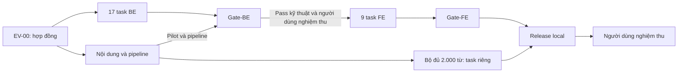

# EnglishVocab — kế hoạch build BE trước, FE sau

> Cập nhật triển khai: người dùng làm một mình, đã bỏ yêu cầu Markdown evidence và reviewer riêng. Hoàn thành task dựa trên mã và kiểm thử thực; theo dõi tại [PHASES.md](PHASES.md). Các yêu cầu evidence/reviewer trong bản kế hoạch ban đầu bên dưới được thay thế bằng cập nhật này. Gate-BE vẫn bắt buộc trước FE.
Ngày: 20/10/2026. Trạng thái: **BE đã đạt kiểm tra kỹ thuật, dừng chờ người dùng nghiệm thu; [PHASES.md](PHASES.md)**. Thư mục làm việc: `/Users/ttcenter/englishvocab` (Git nhận cùng thư mục với tên `/Users/ttcenter/EnglishVocab` trên máy hiện tại). Không sử dụng thư mục tài liệu cũ đã được chuyển đi.

## 1. Baseline trước triển khai và phạm vi hiện tại

Baseline lịch sử: repo tại commit `6c82e0a` chỉ có tài liệu DESIGN.md, FRONTEND.md, TOPICS.md và README.md. Hiện có thêm ảnh tham khảo chưa track trong `assets/hoctumoi.png`, `assets/ontap.png`, `assets/sotay.png`; giữ nguyên các ảnh này và dùng làm đầu vào FE. Git/repo và các thiết kế đã có không được giao lại như công việc chưa làm. Chưa có package, database, service, UI hoặc extension được triển khai. Các preview ở chat là tham khảo FE, không phải source app hoặc bằng chứng nghiệm thu.

Nguồn yêu cầu: [DESIGN.md](DESIGN.md), [FRONTEND.md](FRONTEND.md), [TOPICS.md](TOPICS.md). Backlog chi tiết: [TASKS.md](TASKS.md); bản có cấu trúc: [tasks.json](tasks.json). Nếu backlog và thiết kế mâu thuẫn, sửa tài liệu/hợp đồng trước khi tiếp tục phần bị ảnh hưởng; không âm thầm chọn một luật mới.

## 2. BE trong kiến trúc này là gì?

BE gồm core TypeScript, luật chấm/lịch ôn, IndexedDB/Dexie, service học–ôn–capture, nhập/xuất và backup, adapter tra từ/cache, worker/queue/cầu nối extension, bộ điều khiển giọng US và launcher phục vụ file. Nghiệp vụ chạy trên thiết bị theo thiết kế hiện có; chưa cần Express, Laravel, REST API riêng, PostgreSQL, login, cloud, Docker hoặc AI.

FE là React UI đúng 3 tab, màn phiên học/ôn, Sổ tay và utility panel, Reading/popup, content script giao diện của extension. Phần popup/thanh chọn/vị trí nổi thuộc FE; worker và giao thức capture/ACK phải hoàn thành ở BE trước.

Trước Gate-BE được viết test HTML/harness tối thiểu để kiểm tra browser APIs và extension, nhưng không dựng trang người dùng, component React, CSS sản phẩm hay popup thương mại rồi gọi đó là BE. Không đưa prototype chat vào source app trước gate.

## 3. Thứ tự A–Z và trạng thái ban đầu

- **M0 — EV-00:** Done / Pass.
- **M1 — BE-01…BE-17:** Done / Pass; đã kiểm tra code và Chrome thật.
- **M2 — Nội dung:** pilot, bảng IPA và pipeline đã đạt; thư viện production 677 mục. Bộ đủ 2.000 vị trí chuyển sang P-DATA riêng theo lựa chọn người dùng.
- **M3 — GATE-BE:** kiểm tra kỹ thuật Pass; đang dừng chờ người dùng nghiệm thu. `check:gate` vẫn chặn FE vì chưa có xác nhận này.
- **M4 — FE-01…FE-09:** triển khai 3 tab, phiên học/ôn, Sổ tay, Reading/popup, UI tiện ích và utility. Cả 9 task hiện Blocked bởi Gate-BE, trực tiếp hoặc qua dependency.
- **M5 — GATE-FE:** kiểm tra hành trình thật và giao diện. Hiện Blocked / Not tested.
- **M6 — REL-01, ACCEPT-01:** bản local, hướng dẫn/backup/restore và người dùng dùng thử cuối. Hiện Blocked.

Tổng **38 task = 1 hợp đồng + 17 BE + 7 dữ liệu/pipeline + 1 Gate-BE + 9 FE + 1 Gate-FE + 1 release + 1 nghiệm thu người dùng**. Việc chia task không có nghĩa các agent đã được tạo hoặc các task đã chạy.

## 4. Gate-BE: điều kiện bắt buộc trước mọi task FE

Gate-BE chỉ Pass khi đủ cả năm nhóm:

1. **Nghiệp vụ:** viết sai chưa có progress; viết đúng mới L1; đúng/sai đủ 5 level; level 5 lặp +120h; due tính theo timestamp khi server tắt. Session khôi phục và lần chấm đầu không bị phát lại.
2. **Lưu trữ:** commit nguyên tử, duplicate attempt/capture, version conflict hai tab, native IndexedDB sau restart/migration; backup/restore thật, file lỗi không phá dữ liệu.
3. **Tra/lưu từ:** local → cache → API; live lookup/CORS và lỗi API có evidence; thiếu nghĩa Việt vẫn draft, không bịa CEFR; worker/queue thật giữ dữ liệu khi server tắt; ACK sau commit và gửi lại không trùng.
4. **Dữ liệu và âm thanh:** catalog 100 topic/bộ và thư viện hiện có 677 mục hợp lệ; kiểm tra nhập lại giữ tiến độ; CEFR ước lượng trung thực; bảng IPA chỉ dạng chữ; giọng đọc từ/câu en-US xử lý unavailable đúng, không chuyển sang UK. Hoàn thiện đủ 2.000 vị trí là P-DATA riêng, không chặn kiểm tra kỹ thuật BE.
5. **Kiểm tra và nghiệm thu:** typecheck/lint, unit/integration, native storage/library, live API/CORS, extension và speech đều kiểm tra trên mã hiện tại. Ghi kết quả ngay trong checklist. FE cần thêm xác nhận nghiệm thu BE trực tiếp của người dùng.

**Hệ quả:** thiếu một hạng mục, có Fail/Blocked/Not tested hoặc chưa review thì gate vẫn đóng; không có chế độ “làm FE song song cho nhanh”. Báo cáo phần còn lại, sửa task gốc và kiểm tra lại vùng bị ảnh hưởng.

Thay đổi phạm vi được người dùng xác nhận: “Nghiệm thu BE trước, tách task 2.000 từ”. Kiểm tra kỹ thuật dùng thư viện 677 mục hiện có. Không tự coi lựa chọn tách phạm vi này là người dùng đã nghiệm thu BE.

## 5. Các luật sản phẩm đã chốt

- Học mới: xem đầy đủ → Next ẩn từ/IPA/câu/nút nghe → viết toàn bộ từ đúng → commit L1 +2h → tự chuyển tiếp. Không tự nhận đã biết để tạo level.
- Ôn: cloze trong câu, thiếu ô chưa chấm; lần nộp hợp lệ đầu quyết định; Không nhớ tính sai; sau chấm hiện đáp án và hạn mới.
- Lịch: mới học +2h; đúng L1 +8h, L2 +24h, L3 +48h, L4/L5 +120h; sai mọi level về L1 +2h. Hạn mới từ thời điểm trả lời thực tế.
- Lưu khi đọc chỉ tạo capture/draft/ready, chưa tạo progress. Khác nghĩa là mục riêng; cùng nghĩa giữ tiến độ.
- IELTS B1–C2, giao tiếp A1–B2; CEFR riêng với level; mục cá nhân thiếu CEFR vẫn học được nếu đủ thông tin khác.
- Giọng đọc từ/câu dùng en-US, kể cả từ tự thêm chưa có IPA. Bảng IPA chỉ tra dạng chữ và ví dụ, không phát từng âm.
- Chỉ 3 tab chính, utility ở Sổ tay/menu. Đóng server không ngăn thời gian trôi; extension vẫn lưu và có thể tra API khi có mạng.

## 6. Hợp đồng kỹ thuật cần EV-00 khóa

Các tên dưới đây là đề xuất giao diện nội bộ để lập task; chưa phải API đã triển khai:

- `LearningService`: create/resume/pause session; chuyển front→recall; submitLearn với sessionId/itemId/attemptId/answer/expectedVersion; kết quả retry/committed/conflict/storage-error.
- `ReviewService`: create due session theo source/batch; getQuestion không lộ đáp án; submitReview/markForgotten; getFeedback sau commit; next/resume.
- `QueryService`: tổng quan ba trạng thái, topic progress thực, Sổ tay và bộ lọc.
- `PersonalService`: saveCapture, inspectReady, linkExistingSense, updateDraft; không tạo progress.
- `DictionaryService`: lookup(query, signal, forceOnline), nguồn local/cache/API, các nghĩa và trường có thể thiếu; lỗi phân loại rõ.
- `BackupService`: export/inspect/restore; `ContentService`: validate/inspect/import; `TransferService`: receive/receipt/snapshot/queue-import.
- `AudioService`: list/select US voices, speakEntry (từ/câu ví dụ)/stop; bảng IPA là IpaChartService dạng chữ; unavailable có kiểu lỗi rõ.

Clock là dependency có thể giả lập trong test; UI không tự truyền thời gian để lách lịch. ID mục từ do app quản lý, không dùng vị trí nghĩa trong phản hồi API làm ID ổn định. Mặt câu hỏi chỉ nhận dữ liệu cần hiển thị; dữ liệu đáp án đầy đủ chỉ đưa ra sau chấm theo contract.

## 7. Phân công, file chung và thứ tự tích hợp

Các owner/reviewer trong TASKS.md là vai trò dự kiến để giao việc sau, không phải tên agent đang chạy. COORD giữ contract/gates và tích hợp; CORE giữ domain/storage/services/dictionary/audio; DATA giữ gói nội dung và audio; EXT giữ manifest/worker/bridge; FE giữ app/components/styles/content popup; QA kiểm tra độc lập; USER nghiệm thu cuối.

Một task chỉ có một owner. Reviewer không là người làm chính của task đó. Chủ task không tự ghi Accepted hoặc User accepted. Nếu chỉ có một người/agent làm việc, có thể làm tuần tự nhưng vẫn giữ lượt review và trạng thái Ready for review trước khi đóng.

Owner BE-01/COORD giữ package.json, lockfile, tsconfig và cấu hình test/build; mọi lane khác yêu cầu dependency qua owner đó. BE-02 giữ schema/types, BE-05 giữ DB version/migration. Thay contract/schema phải báo các task phụ thuộc và cập nhật tài liệu trước khi merge; không có nhiều người cùng sửa file chung mà không có bàn giao.

Thứ tự sớm: EV-00 → BE-01 → BE-02 → các nhánh BE-03/04/05/10, BE-17; tiếp tục theo dependency. Pilot nội dung bắt đầu khi BE-12 có validator/import; bốn gói mở rộng bắt đầu sau khi DATA-01 đã review; BE-16 đọc từ/câu độc lập với DATA-06 dạng chữ. EXT bắt đầu sau service capture/lookup/snapshot, bridge sau queue+backup. Gate-BE kiểm tra bản đã tích hợp toàn bộ, rồi mới FE-01.

**Điểm dừng mới:** sau khi hoàn tất BE, dừng để người dùng nghiệm thu. Không tự chuyển sang FE; cần người dùng xác nhận trước khi mở các task FE.

Trong pha BE có thể xử lý các task không phụ thuộc nhau; đây là kế hoạch phụ thuộc, không phải lệnh tự tạo nhiều chat hoặc nhiều agent. Thực thi mặc định tuần tự nếu chưa có yêu cầu phân công chạy song song. Branch dự kiến `codex/<task-id>`; chưa tạo branch/PR trong lần lập kế hoạch. Nếu có PR sau này, mô tả phải kèm phạm vi, cách kiểm tra, giới hạn và evidence.

## 8. Evidence và điều kiện đóng task

Tại `evidence/<ID>/summary.md`, người triển khai ghi: commit và thời điểm; tệp/đầu ra; lệnh/thao tác và kết quả; điều kiện chưa kiểm tra; dữ liệu test dùng; giới hạn; reviewer; kết luận từng tiêu chí. Hình/clip bổ sung cho FE; không thay kiểm tra nghiệp vụ/lưu trữ. Nội dung cần report ngôn ngữ/nguồn, không chỉ schema pass.

`Pass`: đã kiểm tra đạt tiêu chí trên bản nêu rõ. `Fail`: đã kiểm tra và không đạt. `Blocked`: chưa thể làm vì dependency/điều kiện cụ thể. `Not tested`: chưa kiểm tra. Ban đầu mọi verification là Not tested; Blocked chỉ là trạng thái thực thi/phụ thuộc của task, không giả là một kết quả test đã chạy.

Chỉ Done khi owner bàn giao, reviewer đã kiểm tra tiêu chí và evidence đầy đủ. Gate-BE/Gate-FE cần báo cáo tổng hợp cùng commit tích hợp. Mock/fake IndexedDB giúp kiểm tra nhanh nhưng cần native IndexedDB; API fixture giúp lặp lỗi nhưng cần probe live; worker giả lập chưa chứng minh worker Chrome thật. Chưa có CI remote thì ghi Not tested cho CI, không tự báo xanh; local checks vẫn phải có bằng chứng và là phạm vi gate đã mô tả.

## 9. Bàn giao cho agent thực thi

Prompt chung có thể dùng cho từng task:

> Làm task [ID] trong /Users/ttcenter/englishvocab. Đọc DESIGN.md, FRONTEND.md, TOPICS.md, BUILD_PLAN.md và đúng thẻ trong TASKS.md. Kiểm tra dependency/evidence hiện tại; chỉ bắt đầu khi dependency đã đạt. Nếu là FE, bắt buộc Gate-BE Pass và được review. Giữ đúng owner file và contract; hoàn thành đầu ra, kiểm tra phù hợp và evidence; không tự ghi user accepted, không đổi scope/level/lịch để làm test pass. Báo file đã thay, cách kiểm tra, kết quả và phần còn thiếu, rồi bàn giao reviewer.

Task đầu tiên cần thực thi là **EV-00**. Sau khi hoàn thành/review, mở BE-01, rồi BE-02 và các nhánh đủ điều kiện. Đây là kế hoạch để bắt đầu, chưa phải bằng chứng các task đó đang chạy hoặc đã hoàn thành.

## 10. Rủi ro thực tế và cách xử lý

- Bộ 2.000 vị trí có nghĩa Việt, câu, CEFR và nguồn là công việc nội dung lớn. Chia lô 50–100 mục và review; báo phần chưa đạt thay vì tạo nhãn/nguồn giả để đủ số.
- API hoặc môi trường có thể lỗi mạng/CORS/rate limit. Kiểm tra sớm ở BE-10; lỗi ngoài phạm vi xử lý đúng mới báo Blocked, không để FE phát hiện lần đầu.
- Giọng US tùy máy; kiểm tra giọng có sẵn và cập nhật khi thay đổi. Bảng IPA không có audio, không cần tài sản hoặc nghiệm thu phát từng âm.
- Dữ liệu web và extension nằm ở hai vùng riêng. Chứng minh queue/receipt/snapshot/backup trước FE; không dựa vào việc một popup có vẻ báo đã lưu.

Không đặt một ngày hoàn thành giả khi chưa đo tốc độ code, review và tuyển dữ liệu. Timebox trong backlog chỉ để điều hành từng lượt làm việc, không làm điều kiện mở FE thay cho Gate-BE.

### Quy tắc giữ dữ liệu crawl (đã triển khai)

- [x] Giữ toàn bộ nguồn gốc trong `.crawl-cache/` để lọc lại khi mở rộng topic, không chỉ giữ từ đã chọn.
- [x] Thêm `crawl:archive` và `crawl:archive:verify`: snapshot giữ nguồn, seed và kết quả lọc; checksum SHA-256, không ghi đè snapshot cũ, không tự xóa.
- [x] Snapshot đầu đã lưu và kiểm tra 61 file; hướng dẫn sao lưu kho ngoài Git nằm trong README.
- [ ] Tiếp tục tuyển chọn gói từ còn thiếu; snapshot không đồng nghĩa hoàn tất dữ liệu hoặc nghiệm thu BE.
