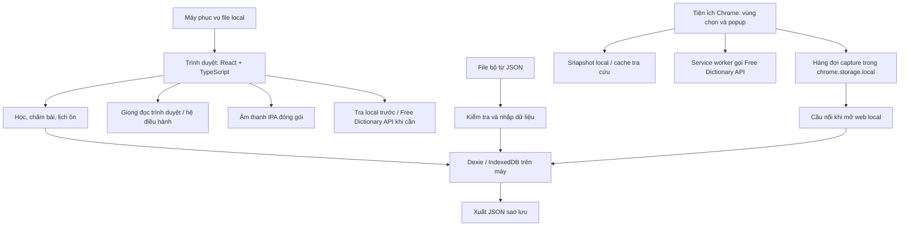
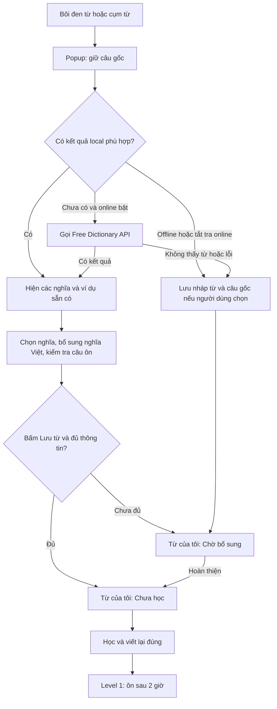

# EnglishVocab — thiết kế ứng dụng học cá nhân

Ngày cập nhật: 20/10/2026. Phiên bản thiết kế: 5 — FE 3 tab, tra local/API và kế hoạch build BE hoàn tất trước FE qua Gate-BE. Trạng thái: BE đã đạt kiểm tra kỹ thuật với 677 mục, đang dừng chờ người dùng nghiệm thu; hoàn thiện bộ 2.000 từ là task nội dung riêng, chưa có FE sản phẩm. Tiến độ thực tế ở PHASES.md. Quy mô được người dùng chốt: 100 topic IELTS (từ B1–C2) và 100 topic giao tiếp (từ A1–B2); tối đa 10 mục/topic. Lịch duy trì level 5 được chốt là mỗi 5 ngày, sai về level 1.

## 1. Quyết định tổng thể

Xây một ứng dụng web chạy trên máy cá nhân, giao diện tiếng Việt, nội dung học tiếng Anh. Một người dùng, một máy và một hồ sơ trình duyệt là phạm vi mặc định. Có thể chuyển sang máy khác bằng file sao lưu.

**Công nghệ đề xuất:** React + TypeScript + Vite; CSS thông thường; IndexedDB qua Dexie để lưu từ và tiến độ; Web Speech API để đọc từ; file JSON để nhập và sao lưu. Bảng IPA chỉ tra cứu dạng chữ; giọng en-US chỉ dùng đọc từ/câu, gồm cả từ tự thêm.

Bổ sung đã chốt: tra và lưu từ khi đọc, gồm popup trong web và tiện ích Chrome cho các trang bên ngoài. Ưu tiên dữ liệu local; chưa có thì gọi **FreeDictionaryAPI.com (dữ liệu Wiktionary)** qua mạng. Người dùng chọn nghĩa, xem ví dụ và lưu vào **Từ của tôi**; chỉ hoàn thành viết lại đúng mới vào level 1. Nghĩa Việt bổ sung/chỉnh thủ công khi thiếu, CEFR chưa xác minh để trống. Không cần API dịch hoặc AI trong bản đầu. Chi tiết ở mục 10.

React phù hợp với các trạng thái xem từ, viết lại, trả lời và hiện kết quả. TypeScript giúp giữ đúng cấu trúc dữ liệu. Dexie giảm phần thao tác IndexedDB và hỗ trợ transaction. Đây là lựa chọn thiết kế cho dự án, không phải yêu cầu bắt buộc của trình duyệt. [Tài liệu Dexie](https://dexie.org/docs/Tutorial/React)

Không cần bổ sung tài khoản, dịch vụ đám mây, cơ sở dữ liệu máy chủ hoặc API trả phí trong phiên bản cá nhân. Chưa thêm PWA, đồng bộ hay thuật toán ôn thích ứng ở giai đoạn đầu.

### Cách mở và vận hành

- Sau khi cài công cụ lần đầu, có một lệnh hoặc launcher `Mở EnglishVocab` để phục vụ bản đã build và mở trình duyệt.
- Dùng cố định `http://localhost:5173`, chỉ lắng nghe trên loopback. Nếu cổng bận, báo lỗi; không âm thầm đổi cổng. Development và bản dùng hằng ngày không chạy đồng thời trên cổng này.
- Tiến trình phục vụ file tĩnh có thể viết bằng Node tích hợp sẵn; không chứa nghiệp vụ và không giữ tiến độ. Vite dùng để phát triển/build. `vite preview` chỉ dùng kiểm tra bản build theo [hướng dẫn Vite](https://vite.dev/guide/static-deploy.html).
- Đóng web hoặc dừng tiến trình không làm mất dữ liệu đã ghi thành công. Khi mở lại, danh sách đến hạn được tính lại.
- Chức năng học, chấm và xem dữ liệu dùng được không cần Internet khi ứng dụng được phục vụ từ máy. Mặc định phát âm Anh-Mỹ (en-US); giọng TTS local dùng được offline, giọng remote và audio API có thể cần mạng.
- Tiện ích tra local và lưu từ độc lập với server local. Khi có mạng, tiện ích gọi Free Dictionary API trực tiếp từ service worker, kể cả server local đang tắt. Mở server và web để chuyển các mục chờ sang thư viện học.

### Sơ đồ trách nhiệm



## 2. Các màn hình và cách sử dụng

**FE đã chốt:** ba tab chính **Ôn tập – Học từ mới – Sổ tay**, theo bố cục tham khảo người dùng gửi. Màn học mới và màn làm bài ôn là phiên con; popup tra từ không phải tab riêng. Reading, IPA, dữ liệu, cài đặt và mục cá nhân mở từ Sổ tay/menu. Đặc tả FE chi tiết ở [FRONTEND.md](FRONTEND.md).

### Ôn tập — trang vào và phần tổng quan

Ưu tiên một nút lớn **Ôn ngay — 80 từ đến hạn**. Con số này bao gồm cả quá hạn, lấy từ dữ liệu thật. Dưới đó là nút Học từ mới, lượt đang học dở và tiến độ hai bộ. Có lối sang Sổ tay để đọc/lưu từ hoặc quản lý Từ của tôi; số mục chờ bổ sung/chưa học hiển thị riêng với số từ đã học.

- Đã học: số mục đã hoàn thành viết lại ít nhất một lần.
- Đến hạn: `nextReviewAt <= now`, bao gồm lượt ôn duy trì level 5.
- Thành thạo: số mục ở level 5; vẫn có lịch ôn duy trì mỗi 5 ngày.
- Tiến độ từng bộ: đã học / số mục thực sự đã có trong bộ. Mục tiêu 1.000 mục/bộ hiển thị riêng; không dùng 1.000 làm mẫu số khi mới nạp 100 mục.
- “Đến hạn trong 2 giờ tới” là số dự báo riêng, không cộng vào số Ôn ngay.

Gợi ý mặc định: học tối đa 10 mục mới mỗi ngày, ôn theo lượt 10 hoặc 20 mục. Người dùng vẫn có thể học tiếp. Đây là giới hạn giảm tải giao diện, không phải kết luận khoa học về số từ phù hợp.

### Học từ mới — danh sách chủ đề

Hai tab IELTS và Giao tiếp; tìm theo tên topic, lọc chưa học/đang học/đã học. Mỗi topic có tối đa 10 mục chính, hiện số đã học và số đang đến hạn. Có thể chọn học tiếp topic dở hoặc ôn các mục đến hạn thuộc topic đó.

Quy mô hoàn chỉnh: 100 topic mỗi bộ, tối đa 1.000 vị trí từ/cụm từ mỗi bộ. Nếu một mục dùng chung giữa hai bộ, tổng số mục duy nhất sẽ thấp hơn 2.000; màn hình phân biệt số vị trí trong bộ và số mục duy nhất.

### Phiên học từ mới

1. Chọn bộ → topic hoặc **Sổ tay → Từ của tôi → Chưa học** → 5 hoặc 10 mục sẵn sàng học; nếu còn ít hơn thì học số còn lại. Mục cá nhân thiếu thông tin bắt buộc nằm ở Chờ bổ sung, chưa vào lượt học.
2. Mặt học: từ, loại từ, nghĩa tiếng Việt theo nghĩa đang học, CEFR, IPA Anh-Mỹ, câu ví dụ, nút nghe thường/nghe chậm và nghe câu. Có thể có hình minh họa; thiếu hình không chặn học. Nguồn nằm trong phần mở rộng. Không thêm một bước xem hình riêng trước mặt học.
3. Bấm **Next / Viết lại**: ẩn cách viết, IPA, câu chứa đáp án và nút nghe; giữ nghĩa, loại từ, tên topic. Nhập toàn bộ từ hoặc cụm từ.
4. Sai: chỉ báo chưa đúng, cho thử lại. Có nút Xem lại quay về mặt học, rồi phải thử viết lại lần nữa. Không đánh dấu đã học khi xem đáp án hoặc bỏ dở.
5. Đúng: ghi tiến độ level 1 và lịch sau 2 giờ trước khi tự chuyển tiếp, kèm thông báo gọn. Không bắt buộc thêm màn phản hồi cần nhấn Tiếp tục riêng. Nếu ghi lỗi, giữ nguyên màn hình và cho lưu lại. Không tự tạo tiến độ bằng nút nhận đã biết từ.
6. Cuối lượt: số mục mới hoàn thành và thời điểm ôn sớm nhất.

Nếu từ đã có tiến độ thì không khởi tạo lại. Xem lại hoặc viết lại tự do không được làm level hiện tại trở về 1.

### Phiên làm bài ôn

Chọn 10/20 mục đến hạn; ưu tiên hạn cũ nhất. Bao gồm mục từ hai bộ hệ thống và Từ của tôi đã học. Có thể lọc theo bộ/topic hoặc thư viện cá nhân. Tạo hàng đợi cố định cho lượt hiện tại; mục vừa đến hạn trong lúc ôn được đưa vào lượt sau. Trước khi chấm mỗi câu, kiểm tra lại phiên bản tiến độ để tránh dùng trạng thái cũ từ tab khác.

Ví dụ giao diện:

> Gợi ý: sở thích · danh từ  
> My favourite **h _ b b _** is reading.  
> Điền vào các ô trống → Kiểm tra

- Các chữ đã cho được giữ cố định; bàn phím đi qua các ô còn thiếu, hỗ trợ Backspace. Khoảng trắng và dấu nối trong cụm từ giữ nguyên. Có nhãn đọc màn hình cho từng vị trí.
- Giấu khoảng một nửa chữ cái, ít nhất một chữ; từ rất ngắn vẫn có bài hợp lệ. Tạo mặt nạ một lần/câu, lưu cùng lượt để tải lại không đổi gợi ý.
- Câu trả lời được ráp lại thành toàn bộ từ rồi mới chấm. Dữ liệu câu đã chỉ rõ đoạn cần khuyết, không thay chuỗi bằng tìm kiếm toàn cục.
- Trước khi nộp: ẩn CEFR, IPA, phát âm và phần nguồn có thể lộ từ. Tắt gợi ý chính tả/tự hoàn thành nếu trình duyệt hỗ trợ.
- Chỉ chấm khi bấm Kiểm tra hoặc Enter; đang gõ chưa tính sai. Nộp rỗng hoặc chưa điền đủ các ô thì nhắc nhập, chưa tính kết quả.
- Lần nộp hợp lệ đầu tiên quyết định đúng/sai. Nút **Không nhớ / Xem đáp án** tính như sai.
- Sau khi nộp: khóa đáp án, hiện phản hồi đúng/sai, từ đầy đủ, IPA, CEFR, nút nghe và lịch tiếp theo; bấm Từ tiếp theo để tiếp tục. Nếu sai có thể viết lại để củng cố, nhưng không tăng level trong chính lượt này.
- Bỏ qua hoặc đóng trước khi nộp: không đổi level hay hạn ôn. Từ còn đến hạn.
- Từ đã thành thạo có thể luyện tự do. Luyện tự do không đổi lịch hoặc thống kê ôn có chấm điểm.

Đây là bài nhớ nghĩa và chính tả có gợi ý; kết quả không tự chứng minh khả năng nói hoặc dùng từ tự nhiên. Có thể bổ sung dạng ẩn toàn bộ từ và câu khác sau này.

### Sổ tay — từ đã học và mục cá nhân

Tìm theo từ hoặc nghĩa; lọc bộ, topic, CEFR, level, đến hạn và hay sai. Hiện CEFR và “Mức nhớ” ở hai cột/nhãn riêng. Cho mở chi tiết, nghe lại, xem lịch sử và ghi chú cá nhân. Không tự nâng CEFR khi lên level.

### Bảng IPA trong Sổ tay/menu

Chia nguyên âm đơn, nguyên âm đôi và phụ âm theo hệ tham khảo Anh-Mỹ. Mỗi hàng có ký hiệu và từ ví dụ; giải thích cách ký hiệu thay đổi theo từ điển và biến thể giọng. Không có nút nghe từng ký hiệu, không cần tệp audio IPA.

Nghe **từ/câu** là chức năng riêng bằng giọng `en-US`. Mọi từ tự thêm, kể cả bản nháp chưa có IPA hoặc kết quả từ điển, có thể được đọc từ chính headword đã lưu khi thiết bị có giọng Mỹ. Không đưa chuỗi ký hiệu IPA vào TTS. Nếu không có giọng Mỹ thì báo unavailable, không tự chọn en-GB. Chưa tạo frontend cho bảng này trước nghiệm thu BE.

### Reading và Từ của tôi

Reading là bảng Đọc & lưu từ trong Sổ tay, cho dán bài và bôi đen từ/cụm từ để tra ngay trong web. Từ của tôi chia **Chờ bổ sung**, **Chưa học**, **Đang ôn** (level 1–4) và **Thành thạo** (level 5, vẫn ôn mỗi 5 ngày). Các mục cá nhân không chiếm chỗ trong giới hạn 10 mục của topic hệ thống. Nút Lưu từ đưa vào Chờ bổ sung hoặc Chưa học theo độ đầy đủ, không tăng số từ đã học. Quy trình popup và dữ liệu ở mục 10.

### Dữ liệu và cài đặt trong Sổ tay/menu

Nhập bộ từ JSON, thêm/sửa mục qua biểu mẫu, xuất/khôi phục sao lưu; chọn giọng Anh-Mỹ có sẵn trên thiết bị và tốc độ. Mặc định giọng/en-US; các cài đặt khác gồm số mục mỗi lượt và số mục mới/ngày. Chỉnh nội dung không tự thay tiến độ. Thay nghĩa đang học phải tạo mục mới thay vì giữ ID cũ.

Cài đặt tra cứu cho phép bật/tắt tra online, tra lại kết quả và xóa cache tra cứu. Xóa cache không xóa mục đã lưu, câu ngữ cảnh hay tiến độ. Có chức năng nhận hàng đợi từ tiện ích và thông báo kết quả chuyển.

## 3. Lịch ôn chính xác

Tất cả khoảng cách tính từ **thời điểm trả lời thực tế**, không từ hạn cũ. Một lượt đến muộn vẫn chỉ tăng một level. Lưu thời gian UTC dưới dạng timestamp; hiển thị theo múi giờ thiết bị.

- Hoàn thành từ mới → level 1 → sau 2 giờ.
- Đúng khi ở level 1 → level 2 → sau 8 giờ.
- Đúng khi ở level 2 → level 3 → sau 24 giờ.
- Đúng khi ở level 3 → level 4 → sau 48 giờ.
- Đúng khi ở level 4 → level 5, được tính thành thạo → ôn lại sau 5 ngày (120 giờ).
- Đúng khi ở level 5 → giữ level 5 → tiếp tục ôn lại sau 5 ngày (120 giờ), lặp lại không giới hạn.
- Sai ở mọi lượt ôn có chấm điểm, kể cả ôn duy trì level 5 → level 1 → sau 2 giờ.

**Quy tắc người dùng đã chốt:** level 5 hiển thị “Thành thạo · ôn mỗi 5 ngày”. Không có trạng thái hoàn tất lịch hay dừng ôn tự động. Mỗi hạn mới tính từ lúc trả lời thực tế. “5 ngày” ở đây là khoảng cách 120 giờ.

Ví dụ trả lời đúng ngay khi đến hạn: từ lúc học xong là mốc 0, các lượt xảy ra ở **+2, +10, +34, +82, +202 và +322 giờ**, rồi tiếp tục mỗi 120 giờ nếu đúng. Đạt level 5 ở +82 giờ; ôn duy trì lần đầu ở +202 giờ. Tắt server/máy không dừng thời gian đến hạn; mở lại thì so sánh timestamp đã lưu với giờ hiện tại.

Không cần tác vụ nền hoặc máy chủ hẹn giờ. Khi mở app, quay lại tab và sau mỗi lần nộp bài thì tính lại số đến hạn. Bộ đếm trên màn hình có thể cập nhật mỗi phút. Đóng web không ngăn thời gian trôi, nhưng bản đầu không có thông báo khi web đã đóng. Thời gian phụ thuộc đồng hồ máy; chỉnh đồng hồ có thể ảnh hưởng hạn ôn.

## 4. Cấu trúc dữ liệu tối thiểu

Một “mục từ” đại diện cho **từ/cụm từ + loại từ + nghĩa cụ thể**. Hai nghĩa khác nhau có ID khác nhau. Cùng một mục xuất hiện trong nhiều topic dùng chung ID và một tiến độ.

### Nội dung

- `collections`: `id`, tên, mô tả; hai bộ hệ thống và vùng Từ của tôi cho các mục tự lưu khi đọc. Phạm vi 100 topic/bộ áp dụng cho hai bộ hệ thống.
- `topics`: `id`, `collectionId`, tên Việt/Anh, thứ tự, thumbnail/icon tùy chọn có alt/nguồn, `entryIds` tối đa 10 và không trùng trong cùng topic. Từ của tôi dùng nhãn cá nhân, không tự chèn thêm vào 10 mục của topic hệ thống.
- `entries`: `id` ổn định, `revision`, `headword`, `partOfSpeech`, `senseKey`, `definitionEn` tùy chọn, `meaningVi` có thể thiếu khi nháp, `acceptedLearnAnswers`, `cefr`, `pronunciation`, `examples`, `illustration` tùy chọn (đường dẫn/URL + alt + nguồn), `provenance`, `contentStatus` draft/ready. Mục ready để học cần từ/dạng gốc, loại từ, nghĩa Việt đã xác nhận, đáp án viết lại và ít nhất một câu khuyết hợp lệ. IPA, audio và CEFR thiếu không chặn học mục cá nhân; vẫn hiện rõ chưa có dữ liệu.
- `cefr`: mức A1–C2 hoặc null, trạng thái `estimated`/`verified`/`unknown`, tham chiếu theo nghĩa và ghi chú. Mục đang chờ kiểm tra vẫn được lưu nháp; không gắn nhãn đã xác minh nếu chưa tra nguồn.
- `pronunciation`: IPA và accent; có thể thêm URL/tệp audio nếu có quyền sử dụng. Bản đầu ưu tiên hệ IPA Anh-Mỹ nhất quán; biến thể Anh-Anh có thể lưu thêm nếu dữ liệu theo nghĩa cần thiết.
- Mỗi `example`: `prefix`, `targetSurface`, `suffix`, đáp án hợp lệ, nguồn. Ví dụ `My favourite ` + `hobby` + ` is reading.`. MVP ưu tiên câu chứa đúng dạng từ gốc; nếu dùng `hobbies` phải khai báo rõ đáp án theo câu.
- `provenance`: nguồn riêng cho nghĩa, IPA, CEFR, ví dụ và audio; gồm URL hoặc định danh, người đóng góp, giấy phép, URL giấy phép, ghi công, thay đổi đã làm và ngày kiểm tra. Dữ liệu tự biên soạn ghi rõ là tự biên soạn; nguồn chưa xác minh có trạng thái riêng.
- `phonemes`: ký hiệu, nhóm âm, hệ tham khảo Anh-Mỹ, từ ví dụ và nguồn tham khảo; không có trường audio; có thể là file nội dung tĩnh thay vì bảng IndexedDB riêng.
- `captures`: các lần chủ động lưu từ khi đọc; giữ vùng chọn, câu gốc, nguồn bài, nghĩa được chọn và liên kết đến mục từ. Nhiều capture có thể liên kết cùng một entry; định nghĩa chi tiết ở mục 10.
- `lookupCache`: dữ liệu tra được từ API theo provider + truy vấn chuẩn hóa, kèm thời gian lấy, định nghĩa, phát âm và nguồn/giấy phép. Cache không tạo entry/progress và không được tính là từ đã lưu. Giới hạn 500 truy vấn gần đây trong mỗi vùng lưu; các mục đã lưu giữ bản nội dung độc lập với cache.

### Tiến độ cá nhân

- `progress`: khóa chính `entryId`; `level` 1–5; `learnedAt` có giá trị sau học đúng lần đầu, `lastReviewedAt` nullable trước lượt ôn đầu, `nextReviewAt` luôn có giá trị, `correctCount`, `wrongCount`, `version`.
- Mọi mục đã học, bao gồm level 5, luôn có hạn ôn tiếp theo. Mục chưa học không có bản ghi progress. Chính sách lịch dùng định danh `fixed-5day-v2` để phân biệt với bản đề xuất cũ chưa được triển khai.
- `reviewEvents`: `id` duy nhất cho lần chấm, `entryId`, mode, thời gian, đúng/sai, level trước/sau, hạn mới, phiên bản nội dung và chính sách lịch. Không cần lưu toàn bộ bài gõ sai.
- `activeSession`: một lượt học hoặc ôn đang dở; danh sách ID, vị trí, giai đoạn, ví dụ/mặt nạ, ID lần chấm và câu đang gõ. Khôi phục sau refresh; khôi phục đúng trạng thái đã chấm thì không chấm lại.
- `settings`: giọng/tốc độ, tùy chọn lượt, phiên bản chính sách lịch, lần xuất sao lưu gần nhất, `onlineLookupEnabled` (mặc định bật) và `lookupProvider` cố định `free-dictionary-v2` cho bản đầu.
- Trạng thái thư viện tính từ `contentStatus` và progress: draft → Chờ bổ sung; ready không có progress → Chưa học; có progress L1–L4 → Đang ôn; có progress L5 → Thành thạo. Trạng thái chuyển từ tiện ích và trạng thái tra API là các trường riêng, không dùng làm level nhớ.

Index cần thiết: `progress.nextReviewAt`, `progress.level`, `reviewEvents.entryId`, `reviewEvents.reviewedAt`, `topics.collectionId`. Với khoảng 2.000 mục, tìm kiếm chuỗi đã chuẩn hóa trong bộ nhớ là đủ; chưa cần dịch vụ tìm kiếm.

### Ghi dữ liệu an toàn

Một lần chấm cập nhật progress + thêm event + cập nhật activeSession trong cùng transaction. Dùng ID lần chấm duy nhất, vô hiệu hóa nút khi đang lưu; trong transaction kiểm tra `progress.version` và event đã tồn tại. Nếu một tab khác đã cập nhật, yêu cầu tải lại câu thay vì áp dụng đáp án cũ.

Chỉ báo thành công và chuyển câu sau khi transaction hoàn tất. Lỗi lưu giữ lại câu trả lời, hiện nút thử lưu lại và không tăng level trên giao diện. Các thao tác mạng/phát âm không đặt trong transaction. [Dexie transaction](https://dexie.org/docs/Dexie/Dexie.transaction())

## 5. Quy tắc chấm

Chuẩn hóa Unicode NFKC, bỏ khoảng trắng hai đầu, gộp khoảng trắng lặp và so sánh không phân biệt hoa/thường. Chuẩn hóa dấu nháy cong thành thẳng. Không tự xóa mọi dấu câu, không chấp nhận lỗi chính tả gần giống.

Biến thể Anh-Mỹ/Anh-Anh chỉ chấp nhận khi khai báo trong danh sách đáp án, ví dụ `favorite`/`favourite`. Bản đầu ưu tiên chính tả Anh-Mỹ khi tự biên soạn nội dung; vẫn nhận biến thể Anh-Anh đã khai báo. Với bài điền ô, cấu trúc hiển thị cố định theo dạng trong câu; biến thể khác số chữ được kiểm tra ở chế độ nhập cả từ hoặc dùng câu riêng.

Các từ đồng nghĩa không tự được tính đúng vì đây là luyện một mục cụ thể. Không dùng AI để chấm: luật xác định giúp kết quả nhanh, miễn phí và dùng được offline.

## 6. Dữ liệu từ vựng và phát âm

### Lộ trình nội dung

1. Lập khung 100 topic/bộ, nhưng chỉ hiển thị topic có nội dung sử dụng được; đánh dấu rõ số topic đã có so với mục tiêu.
2. Làm thử 10 topic/bộ × 10 mục = 200 vị trí nội dung. Kiểm tra nghĩa, cách dùng, chính tả, IPA, CEFR và bài khuyết từ.
3. Sau khi luồng học–ôn ổn định, bổ sung từng gói đến 100 topic/bộ. Duy trì `contentVersion` và ID để cập nhật nội dung không xóa tiến độ.

Chọn từ theo mức hữu ích và chủ đề: bộ IELTS chỉ tuyển trong B1–C2; bộ Giao tiếp chỉ tuyển trong A1–B2, theo từng từ/nghĩa. Không chia đều giả tạo các mức. Danh mục 100 topic mỗi bộ nằm trong [TOPICS.md](TOPICS.md). “IELTS Vocabulary” là tên bộ nội dung; không gán band IELTS cho từng từ. CEFR luôn hiển thị là mức tham khảo theo nghĩa.

[Kaikki](https://kaikki.org/) cung cấp dữ liệu từ điển dạng máy đọc từ Wiktionary, có thể dùng làm đầu vào tuyển chọn. Không cần tải toàn bộ vào app; chỉ đóng gói các mục đã chọn. Ví dụ có thể tự viết rồi kiểm tra hoặc lấy từ nguồn cho phép. [Tatoeba](https://tatoeba.org/en/downloads) phân biệt giấy phép câu và audio; không áp một nhãn giấy phép chung cho mọi tài sản.

English Vocabulary Profile là nguồn tham khảo do người dùng đề xuất. Trong lần thiết kế này trang không trả về nội dung đọc được để xác minh điều khoản, nên chưa thiết kế tự động thu thập hoặc khẳng định quyền tái sử dụng. Nhãn CEFR tự ước lượng phải hiện “ước lượng”, không ghi nguồn EVP khi chưa đối chiếu.

### Giọng đọc từ và câu

Dùng `speechSynthesis.getVoices()` và cập nhật danh sách qua sự kiện `voiceschanged`. Mặc định chọn giọng có locale `en-US`; nếu thiết bị có nhiều giọng Anh-Mỹ thì cho người dùng chọn giữa các giọng đó và lưu lựa chọn. Không tự chuyển sang `en-GB` nếu không tìm thấy `en-US`; báo chưa có giọng Anh-Mỹ, trong khi các chức năng khác vẫn dùng được. [MDN getVoices](https://developer.mozilla.org/en-US/docs/Web/API/SpeechSynthesis/getVoices)

Nếu thiết bị có giọng Anh-Mỹ local thì dùng được offline. Giọng Anh-Mỹ remote có thể cần Internet. Giọng Google chỉ là lựa chọn khi trình duyệt/hệ điều hành thật sự cung cấp; không tích hợp Google TTS trả phí hay endpoint không chính thức. [MDN localService](https://developer.mozilla.org/en-US/docs/Web/API/SpeechSynthesisVoice/localService)

Với audio từ/câu đi kèm kết quả tra, chỉ phát tệp được xác định là giọng Anh-Mỹ. Nếu nguồn trả audio Anh-Anh hoặc không cho biết accent, ưu tiên giọng `en-US` qua TTS để đọc từ/câu nếu có; nếu không có thì báo audio Anh-Mỹ chưa sẵn sàng. Riêng nghe từng âm trong bảng IPA bắt buộc dùng tệp âm đã kiểm tra, không đưa ký hiệu IPA cho TTS. Lưu accent của từng audio theo metadata nguồn.

## 7. Lưu trữ, nhập và sao lưu

IndexedDB là bộ nhớ chính, không dùng localStorage cho toàn bộ từ/lịch sử. Dữ liệu thuộc trình duyệt, profile và origin cụ thể. Đổi `localhost` thành `127.0.0.1`, đổi cổng hoặc đổi trình duyệt sẽ tạo vùng dữ liệu khác. App có thể xin lưu trữ bền vững và hiển thị kết quả được cấp/từ chối; không coi tính năng này là bản sao lưu. [MDN lưu trữ](https://developer.mozilla.org/en-US/docs/Web/API/Storage_API/Storage_quotas_and_eviction_criteria), [MDN persist](https://developer.mozilla.org/en-US/docs/Web/API/StorageManager/persist)

### Nhập nội dung

JSON là định dạng chính vì giữ được nghĩa, ví dụ, nguồn và biến thể; chưa cần hỗ trợ CSV trong v1. Trước khi ghi, kiểm tra phiên bản định dạng, ID, tham chiếu topic, tối đa 10 mục/topic, CEFR hợp lệ, đoạn cần khuyết và trường ghi công.

Hiện bản xem trước số mục mới/cập nhật/lỗi; từ chối cả gói nếu có lỗi cấu trúc. Không ghi dở dang. Mặc định cập nhật nội dung theo ID và không đụng progress. Nội dung nhập hiển thị như văn bản, không chạy HTML/script từ file. Biểu mẫu tự thêm từ tạo ID ổn định và cùng bộ kiểm tra như nhập file.

### Sao lưu và khôi phục

File `englishvocab-backup-YYYY-MM-DD.json` gồm `schemaVersion`, `contentVersion`, `schedulePolicyVersion`, `exportedAt`, toàn bộ nội dung, mục cá nhân và captures đã nhận, tiến độ, lịch sử, phiên đang dở, cài đặt và ghi công. Không cần sao lưu lookupCache vì có thể tra lại. Audio đóng gói có manifest phiên bản; audio API lưu URL + thông tin nguồn, chưa tải tự động vào backup; nghe URL đó cần mạng, có thể dùng TTS local thay thế nếu có. V1 không nhận tệp audio tùy biến, tránh sao lưu JSON bị thiếu âm thanh cá nhân.

- Nút Xuất sao lưu tải file về máy; không gọi việc lưu IndexedDB là đã sao lưu.
- Nhắc nhẹ nếu quá 7 ngày chưa xuất, chỉ khi mở app. Hiển thị ngày “đã xuất” vì web không xác minh được người dùng còn giữ tệp.
- Khôi phục v1 dùng chế độ thay thế toàn bộ để tránh quy tắc hòa trộn tiến độ phức tạp. Kiểm tra phiên bản và tham chiếu, xem trước số mục/tiến độ, yêu cầu xuất bản hiện tại rồi người dùng xác nhận thay thế.
- Khôi phục trong một transaction; có lỗi thì rollback. File có schema mới hơn mức hỗ trợ bị từ chối với thông báo rõ.
- Không có đồng bộ tự động giữa máy/điện thoại. Xóa dữ liệu website, profile hoặc dùng chế độ riêng tư có thể làm mất dữ liệu; bản sao lưu nằm ngoài trình duyệt là đường khôi phục.

## 8. Cấu trúc mã và thứ tự thực hiện

Cấu trúc đề xuất, chưa tạo mã ứng dụng:

```text
src/
  app/                 bố cục, điều hướng, khởi tạo
  features/
    dashboard/ topics/ learn/ review/ learned/ ipa/ data/
    reading/ personal/ lookup/
  domain/
    scheduler.ts       luật chuyển level, nhận now để kiểm thử
    grading.ts         chuẩn hóa và kiểm tra đáp án
    cloze.ts           mặt nạ và ráp chữ còn thiếu
  storage/
    db.ts              schema, migration, transaction
    progress.ts        đọc/ghi tiến độ và sự kiện
    backup.ts          kiểm tra, xuất và khôi phục
  content/             kiểu dữ liệu và kiểm tra gói từ
  audio/               chọn giọng en-US và đọc từ/câu
  dictionary/
    freeDictionary.ts  gọi API và ánh xạ các nghĩa/phát âm
    cache.ts           tra local và cache có giới hạn
    types.ts           dữ liệu tra độc lập với entry đã lưu
public/
  content/             gói từ có phiên bản
scripts/
  serve.mjs            phục vụ bản build trên loopback, cổng cố định
extension/
  manifest.json        Manifest V3, quyền trang đọc và host API
  content.ts           vùng chọn, popup và câu ngữ cảnh
  service-worker.ts    tra API, lưu hàng đợi bền vững
  bridge.ts            chuyển capture trên trang web local
```

Giữ state giao diện trong React; Dexie là nguồn tiến độ duy nhất. Chưa cần Redux, API REST hoặc ORM máy chủ. Viết hàm lịch ôn độc lập với UI, không hardcode thời gian trong component.

**Thứ tự bắt buộc mới theo yêu cầu người dùng: hoàn thành BE trước rồi mới làm FE.** Kế hoạch đầy đủ ở [BUILD_PLAN.md](BUILD_PLAN.md), 38 task ở [TASKS.md](TASKS.md) và [tasks.json](tasks.json).

1. EV-00 chốt contract và quyền sở hữu file; BE-01…BE-17 triển khai core/lưu trữ/học–ôn/tra từ/worker/cầu nối/audio/launcher, chưa có UI sản phẩm.
2. Pilot, bảng IPA và pipeline đã hoàn tất; thư viện hiện có 677 mục. Theo lựa chọn người dùng, DATA-02…DATA-05 hoàn thiện 2.000 vị trí trong một track nội dung riêng, không chặn nghiệm thu BE.
3. Gate-BE kỹ thuật đã Pass sau kiểm tra core/native browser/extension/audio. FE vẫn Blocked đến khi người dùng nghiệm thu BE trực tiếp; không tự ghi đã nghiệm thu.
4. Sau Gate-BE mới triển khai FE-01…FE-09 đúng 3 tab, phiên học/ôn, Sổ tay, Reading/popup, UI extension và utility theo FRONTEND.md.
5. Gate-FE kiểm tra tích hợp/hiển thị, rồi REL-01 đóng gói và ACCEPT-01 để người dùng nghiệm thu bản local.

Hiện tại BE đã triển khai và kiểm tra; chờ người dùng nghiệm thu. FE chưa triển khai; nội dung đầy đủ còn trong P-DATA.

## 9. Tiêu chí nghiệm thu

Các mục dưới đây là điều kiện cần kiểm thử khi triển khai, **chưa phải kết quả Pass hiện tại**:

- Viết sai ở bước học không tạo progress; viết đúng tạo đúng một progress level 1, hạn +2 giờ.
- Đủ chuỗi đúng cho các hạn +2/+10/+34/+82/+202/+322 giờ khi trả lời đúng hạn; level 5 tiếp tục hẹn sau 120 giờ ở mỗi lần đúng, không có hạn null.
- Sai ở từng level, kể cả level 5 duy trì, về level 1 và hạn +2 giờ.
- Ôn trễ chỉ tăng một level; hạn mới tính từ giờ trả lời. Từ chưa đến hạn không vào lượt chấm.
- CEFR không thay đổi khi chuyển level; mục dùng chung topic không bị tính thành hai từ toàn cục.
- Bấm hai lần hoặc hai tab nộp cùng câu không nâng level hai lần; refresh sau khi chấm không chấm lại.
- Bỏ dở, thoát giữa lượt, mở lại và mất mạng vẫn giữ trạng thái đã commit; không mất mục chưa ôn.
- Mặt trước ôn không lộ đáp án qua IPA, nút nghe, ví dụ khác hoặc nguồn đang hiển thị.
- Cụm từ, dấu nối, biến thể khai báo và câu có dạng biến đổi được chấm đúng quy tắc.
- Export → khôi phục vào vùng dữ liệu sạch giữ nguyên ID, level, hạn, lịch sử và tham chiếu nội dung; file lỗi không làm thay đổi dữ liệu.
- Lỗi quota/ghi dữ liệu không báo hoàn thành giả; người dùng giữ được câu đang trả lời để thử lưu lại.
- Bảng IPA dạng chữ có ký hiệu, phân nhóm, từ ví dụ và nguồn; không có âm thanh từng ký hiệu. Giọng đọc từ/câu en-US hoạt động độc lập với việc có IPA hay không.
- Hai bộ có đúng 100 topic, tối đa 10 mục/topic ở bản nội dung hoàn chỉnh; báo riêng vị trí từ và số mục duy nhất.

Kiểm thử tự động nên tập trung vào scheduler, chấm, kiểm tra gói và transaction; kiểm thử trình duyệt tập trung luồng học–ôn–refresh–sao lưu. Phần phát âm cần nghe kiểm tra trên trình duyệt thực tế, không chỉ xác nhận nút có phản hồi.

## 10. Bôi đen, tra nghĩa và lưu từ khi đọc

### Nguồn tra đã chốt

Dùng **FreeDictionaryAPI.com** làm nguồn tra online: `GET https://freedictionaryapi.com/api/v1/entries/en/{word}`. Nguồn miễn phí, không cần API key, đã kiểm tra CORS từ localhost bằng Chrome thật. Giới hạn công bố 1.000 yêu cầu/giờ/IP; nhận 429 thì báo chờ, không tự retry. Nguồn dictionaryapi.dev cũ đang lỗi CORS/HTTP 530 trong kiểm tra thực tế nên không còn là provider mặc định. [Tài liệu nguồn hiện dùng](https://freedictionaryapi.com/).

Dữ liệu tra có thể gồm nhiều mục/nghĩa, loại từ, định nghĩa tiếng Anh, IPA, audio, ví dụ, đồng nghĩa và trái nghĩa. Không mặc định nghĩa đầu tiên đúng ngữ cảnh hoặc mọi từ đều có ví dụ/audio. Cấu trúc công bố không cung cấp sẵn bản dịch tiếng Việt hoặc CEFR; bản đầu không tự thêm dịch vụ dịch/AI để điền hai trường này.

Giữ link Wiktionary gốc và giấy phép CC BY-SA 4.0 từ phản hồi cho từng nghĩa/IPA. Hiện ghi công FreeDictionaryAPI.com trong vùng nguồn của popup và thông tin ứng dụng. Chỉ nhãn General American/US rõ ràng được đánh dấu en-US; accent khác hoặc không rõ không chuyển thành US. Nguồn này không cung cấp audio: từ/câu dùng giọng en-US của thiết bị. Không tự suy đoán nghĩa Việt hoặc CEFR.

### Workflow từ lúc đọc đến lúc ôn

1. Người dùng đọc bài và bôi đen một từ hoặc cụm từ.
2. Popup mở gần vùng chọn; giữ lại vùng chọn và câu chứa từ trước khi tương tác popup làm mất selection.
3. Tra dữ liệu local trước: các mục đã đóng gói, mục cá nhân đã lưu và cache tra cứu. Trong tiện ích dùng snapshot/cache riêng, không giả định đọc được IndexedDB của web.
4. Nếu chưa có kết quả phù hợp và đang bật tra online, gọi Free Dictionary API. Nếu local có mục nhưng thiếu nghĩa người dùng cần, có nút **Tra thêm online**; không tự ghi đè mục đã học.
5. Popup hiển thị các nghĩa và loại từ để người dùng chọn; hiện IPA/audio và ví dụ thực sự có. Câu gốc đang đọc là một khối riêng, không bị đổi thành ví dụ từ API.
6. Người dùng bổ sung/chỉnh nghĩa Việt, kiểm tra dạng gốc, chọn câu dùng để ôn và có thể thêm ghi chú. CEFR không có thì để trống; không phải trường bắt buộc để lưu hoặc học mục cá nhân.
7. Bấm **Lưu từ**. Nếu thông tin đủ để học thì vào **Từ của tôi → Chưa học**; thiếu trường bắt buộc thì vào **Chờ bổ sung**. Popup báo rõ nơi đã lưu; thao tác tra đơn thuần không tạo mục cá nhân.
8. Mở Từ của tôi, hoàn thiện nháp nếu cần, rồi học theo cùng luồng xem từ → ẩn từ → viết lại.
9. Chỉ khi viết lại đúng và lưu thành công mới tạo progress level 1, hạn +2 giờ. Sau đó dùng chung lịch ôn L1–L5, level 5 mỗi 5 ngày và sai ở mọi level về L1 +2 giờ.



### Nội dung popup và trạng thái thư viện

Popup gồm từ/dạng gốc, loại từ và các nghĩa tiếng Anh có thể chọn; ô **Nghĩa tiếng Việt** cho nhập/sửa; IPA theo Anh-Mỹ và nút nghe giọng Anh-Mỹ khi có; CEFR local nếu đã có theo đúng nghĩa, còn lại là chưa xác minh; câu gốc; tối đa 3 ví dụ của nghĩa đang chọn khi có; ghi chú; nguồn mở rộng; nút **Lưu từ**. Chỉ hiện audio API nếu xác định được audio đó là Anh-Mỹ.

Không ép người dùng điền nghĩa Việt ngay trong lúc đọc: vẫn cho lưu nháp để tiếp tục bài. Khi thiếu ví dụ từ API, có thể dùng câu gốc đã kiểm tra làm bài khuyết. Nếu không lấy được câu gốc, cho nhập/chỉnh câu trong popup hoặc bổ sung sau. Không lấy ví dụ của nghĩa khác chỉ để lấp chỗ trống.

Một mục cá nhân đủ để bắt đầu học khi có: từ/dạng gốc, loại từ, nghĩa Việt do người dùng xác nhận, đáp án viết lại và ít nhất một câu chứa đúng đoạn đáp án đã đánh dấu. Mục thiếu IPA/audio/CEFR vẫn có thể học, nhưng các trường đó hiện rõ chưa có dữ liệu. Không chặn lưu chỉ vì API thiếu trường.

**Chờ bổ sung** và **Chưa học** đều chưa có level. **Đang ôn** là L1–L4; **Thành thạo** là L5 và vẫn có hạn ôn. Từ mới lưu không tăng số đã học hay số đến hạn; chỉ tăng số mục cá nhân trong nhóm tương ứng.

Nếu cùng từ/nghĩa đã tồn tại, cho chọn **Đã có — lưu thêm ngữ cảnh** để tạo capture liên kết entry hiện có, giữ nguyên level/hạn. Nghĩa khác tạo entry riêng. Không tự gộp chỉ vì giống mặt chữ, và không thay nghĩa của entry đã học bằng nghĩa mới từ API.

Từ tự lưu không bị giới hạn trong 2.000 vị trí nội dung hoặc phạm vi CEFR của hai bộ hệ thống. Mặc định nằm trong thư viện cá nhân; chỉ khi gán vào topic hệ thống mới kiểm tra phạm vi CEFR và tối đa 10 mục/topic.

### Phạm vi đọc và cách gọi API

- **Trong web EnglishVocab:** Reading cho dán văn bản và tùy chọn nhập tiêu đề/URL nguồn; popup xử lý vùng chọn trong trang. Dùng adapter Free Dictionary API qua fetch; cần kiểm tra CORS từ origin local khi triển khai. Chưa thêm tải bài từ URL, OCR hoặc đọc PDF.
- **Trên trang web khác:** tiện ích Chrome Manifest V3 hiển thị popup bằng content script. Người dùng bật tiện ích trên trang đang đọc hoặc cấp quyền cho website thường dùng; có thêm menu chuột phải “Tra và lưu vào EnglishVocab”. Chỉ bôi đen không tự cấp quyền activeTab.
- **Tra online trong tiện ích:** content script gửi từ cần tra đến service worker; worker gọi cố định host `https://freedictionaryapi.com/` với host permission phù hợp rồi gửi kết quả về. Không đưa URL bất kỳ của trang đọc vào hàm gọi mạng và không cần server local giữ API key.
- Chỉ gửi từ/cụm từ cần tra cho nguồn tra; không gửi cả bài, câu gốc hoặc URL bài đọc. Đây là tra từ, chưa có tự động xác định nghĩa theo toàn bộ ngữ cảnh.
- Bản đầu hỗ trợ văn bản HTML thông thường. Trang nội bộ trình duyệt, PDF, ảnh và một số khung nhúng cần cách xử lý khác; khi không đọc được ngữ cảnh thì vẫn có đường nhập thủ công trong Reading/Từ của tôi.

Cách gọi từ extension service worker và quyền host được mô tả trong [Chrome cross-origin requests](https://developer.chrome.com/docs/extensions/develop/concepts/network-requests). Quyền trang đọc và vùng chọn theo [activeTab](https://developer.chrome.com/docs/extensions/develop/concepts/activeTab), [contextMenus](https://developer.chrome.com/docs/extensions/reference/api/contextMenus).

### Local, cache và lỗi tra cứu

Thứ tự tra: entry local phù hợp → lookupCache → API nếu online được bật. Hiển thị nguồn và thời gian lấy kết quả cache; có nút tra lại online. Cache mới không ghi đè nội dung cá nhân đã sửa. Bản đầu chưa tải một bộ từ điển offline lớn ngoài các gói học và các mục đã tra/lưu.

Cache chỉ phục vụ tốc độ và khả năng tra lại offline, không phải thư viện học hoặc sao lưu. Giới hạn 500 truy vấn gần đây; nếu ghi cache lỗi thì vẫn cho xem kết quả vừa nhận. Riêng nút Lưu từ chỉ báo thành công sau khi capture được ghi bền vững. Có thể xóa cache mà không xóa nội dung của entry/capture đã lưu.

Phân biệt trạng thái đang tra, có kết quả, không tìm thấy và lỗi mạng/dịch vụ. Timeout đề xuất 10 giây; có nút Thử lại, không lặp request vô hạn. Kết quả không tìm thấy được coi là khác với lỗi mạng. HTTP 429 tôn trọng Retry-After nếu có. Không có cam kết mọi từ/cụm từ đều tìm thấy hoặc dịch vụ luôn sẵn sàng.

Khi chọn từ khác trước lúc request cũ hoàn tất, hủy/bỏ kết quả cũ bằng ID truy vấn để tránh popup hiện nghĩa của từ trước. Khi nhiều thao tác cùng tra một từ, dùng chung request đang chạy. Các API field thiếu hoặc audio URL rỗng không gây lỗi popup.

Nếu API lỗi, offline, tắt tra online hoặc không tìm thấy từ: cho lưu selectedText + câu gốc + nguồn bài dưới dạng Chờ bổ sung, có thể nhập nghĩa thủ công. Không tự tạo định nghĩa, ví dụ hoặc CEFR giả. Cụm từ không tìm thấy cũng không bị tách thành các từ đơn rồi coi như đã giải nghĩa đúng cả cụm.

### Lưu khi server local đang tắt

Với trang đọc đã được cấp quyền, tiện ích vẫn tra snapshot/cache và lưu hàng đợi khi server local tắt. Có Internet và quyền host API thì worker vẫn gọi Free Dictionary API được; phần này không phụ thuộc server local. Không có Internet vẫn lưu nháp và tra những dữ liệu đã có local.

Hàng đợi capture lưu bền vững trong `chrome.storage.local`, không chỉ trong RAM của popup/service worker. Khi ghi thành công, báo **Đã lưu trên tiện ích · chờ chuyển vào web**; nếu lỗi/quá quota thì báo chưa lưu và cho thử lại. Đóng popup hoặc trình duyệt sau khi ghi thành công không được làm mất hàng đợi.

Khi bật server và mở EnglishVocab, tiện ích chuyển các capture đang chờ qua cầu nối thông điệp trên trang local. Web kiểm tra dữ liệu, tạo/liên kết entry và ghi capture trong một transaction; chỉ gửi xác nhận sau commit. Khi đó tiện ích mới bỏ mục khỏi hàng đợi. Dùng captureId duy nhất để gửi lại sau mất kết nối không tạo trùng. Chuyển vào web không tạo progress.

Storage tiện ích và IndexedDB web là hai vùng riêng. Cầu nối giới hạn đúng origin local cố định, kiểm tra kiểu/kích thước/nội dung thông điệp và không truyền hàng đợi cho website đang đọc. Không cần thêm API HTTP/backend nghiệp vụ chỉ để chuyển capture. [Chrome storage](https://developer.chrome.com/docs/extensions/reference/api/storage), [message passing](https://developer.chrome.com/docs/extensions/develop/concepts/messaging)

### Dữ liệu cần giữ và sao lưu

`captures` giữ: captureId, selectedText, dạng gốc đã xác nhận nếu có, loại từ/nghĩa đã chọn, definitionEn, meaningVi có thể thiếu, entryId nullable, câu gốc, vị trí đoạn cần khuyết, tiêu đề/URL bài, thời điểm lưu và ghi chú. Kết quả tra được giữ riêng theo nghĩa: provider, queriedWord, fetchedAt, chỉ mục mục/nghĩa trong phản hồi để tham chiếu, định nghĩa, ví dụ, IPA/audio, sourceUrls và metadata giấy phép. Chỉ mục API không được dùng làm ID ổn định của mục học.

Entry có ID nội bộ ổn định sau khi được tạo. Giữ nội dung cần dùng của nghĩa người dùng chọn thay vì phụ thuộc cache còn tồn tại. Khi một entry đã có tiến độ, cập nhật API không làm mất nghĩa Việt người dùng sửa, đổi nghĩa hoặc reset progress.

Với dạng biến đổi như policies, gợi ý policy làm dạng gốc nhưng giữ policies trong câu gốc để bài ôn dùng đúng dạng. Không giả định API tự suy ra mọi biến thể; người dùng xác nhận dạng gốc. Với read và các từ có nhiều cách đọc, hiển thị các IPA ứng viên có nguồn, chưa khẳng định đã khớp thì/nghĩa nếu chưa kiểm tra được.

Sao lưu web bao gồm entry cá nhân và captures đã nhận; không bao gồm hàng đợi chưa chuyển ở tiện ích. Tiện ích có nút xuất JSON hàng đợi riêng; web nhập file này theo captureId để không tạo trùng. Cả hai đường nhập đều không tự tạo L1. Audio API được sao lưu bằng URL + nguồn/giấy phép; chưa đóng gói file audio remote cho offline. Có thể dùng TTS local khi khả dụng.

### Tiêu chí triển khai và nghiệm thu bổ sung

Các mục sau là yêu cầu cần kiểm thử khi triển khai, chưa phải kết quả đã kiểm thử:

- Có entry local phù hợp: hiện ngay, không cần gọi API; có nút tra thêm khi cần nghĩa khác.
- Chưa có local/cache: tra Free Dictionary API; chọn đúng nghĩa và chỉ hiện ví dụ thuộc nghĩa đó.
- Tra đơn thuần/cache kết quả không tạo entry cá nhân hoặc progress; chỉ bấm Lưu mới tạo capture.
- API thiếu nghĩa Việt/CEFR/ví dụ/audio vẫn mở popup được; nghĩa Việt có ô sửa, CEFR để trống, có thể dùng câu gốc hợp lệ.
- Thiếu thông tin bắt buộc vẫn lưu nháp được; đủ thông tin nhưng chưa học thì vào Chưa học, chưa có hạn ôn.
- Viết lại đúng lần đầu tạo đúng một L1 +2 giờ; từ cá nhân sau đó đi theo lịch giống hai bộ hệ thống.
- API lỗi, offline, timeout, 429 hoặc không có từ không làm mất vùng chọn/câu gốc hay chặn lưu nháp.
- Request trả về sai thứ tự không hiện nghĩa của từ cũ; nhiều nghĩa/entry và cụm từ không tìm thấy được xử lý rõ.
- Server tắt vẫn lưu và tra API qua tiện ích khi có mạng; đóng/mở trình duyệt vẫn còn hàng đợi đã ghi thành công.
- Web chỉ ACK sau commit; gửi/chuyển/nhập capture nhiều lần không tạo trùng hoặc reset level của từ đã học.
- Xóa/đổi cache không xóa entry, ghi chú, nguồn và progress đã lưu; quota lỗi không báo lưu thành công giả.
- Kiểm tra CORS thực tế từ web local, host permission từ tiện ích, phát âm có/không mạng và ghi công theo nội dung/audio.
- Export/import web và export/import hàng đợi giữ đúng nghĩa, câu gốc, đoạn khuyết, nguồn và trạng thái, không tự tính đã học.

Chưa triển khai web, crawl bộ từ, cài tiện ích hoặc thêm API dịch trong lần cập nhật thiết kế này.
