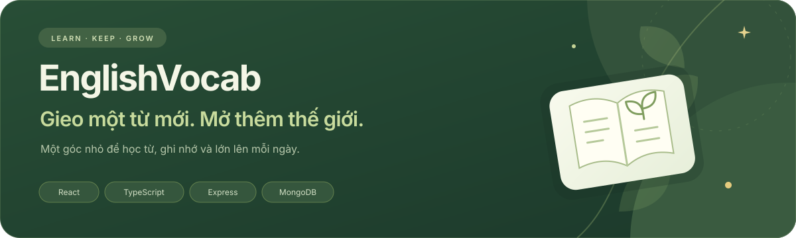

<p align="center">
  
</p>

<div align="center">
  
  <h3>Mỗi ngày một chút, nhớ lâu hơn.</h3>
  <p>Học từ mới · Ôn đúng lúc · Giữ những từ bạn yêu thích</p>
  <p>
    <a href="https://englishvocab-ten.vercel.app"><strong>Mở website ↗</strong></a>
    &nbsp; · &nbsp;
    <a href="#trải-nghiệm">Khám phá</a>
    &nbsp; · &nbsp;
    <a href="#bắt-đầu-tại-máy-của-bạn">Cài đặt</a>
    &nbsp; · &nbsp;
    <a href="#extension--gặp-từ-hay-lưu-lại-ngay">Extension</a>
    &nbsp; · &nbsp;
    <a href="#dành-cho-người-phát-triển">Tài liệu</a>
  </p>
</div>

---

## Một góc học có người bạn đồng hành

**EnglishVocab** là ứng dụng học và ôn từ vựng tiếng Anh với sổ tay cá nhân, lịch ôn và một linh thú nhỏ luôn ở bên. Giao diện mang tông xanh rừng, kem và vàng ấm; các tương tác nhẹ nhàng giúp mỗi lượt học bớt khô khan.

Bạn có thể bắt đầu bằng một từ, lưu những điều mình gặp khi đọc và quay lại để nhớ thêm từng chút. Tiến độ được lưu theo tài khoản trong MongoDB; web và Chrome extension cùng làm việc qua API.

## Trải nghiệm

### 🌱 Học theo nhịp của bạn

- Khám phá các chủ đề **IELTS** và **giao tiếp hằng ngày**, trình bày dạng danh sách dễ theo dõi.
- Nghe phát âm Anh–Mỹ, xem nghĩa và ví dụ, rồi thử viết lại từ vừa học.
- Từ viết đúng được thêm vào sổ tay và lịch ôn. Từ bỏ qua không được thêm vào lịch ôn.
- Có thể lưu nháp, tạm dừng và tiếp tục phiên đang dở.

### 📖 Một cuốn sổ tay của riêng mình

- Quản lý **Từ đã học** và **Từ của tôi**; tự thêm hoặc chỉnh sửa từ cá nhân.
- Tìm bằng từ tiếng Anh hoặc nghĩa tiếng Việt; lọc CEFR, mức ghi nhớ, trạng thái và từ đến hạn.
- Bật/tắt ôn tập cho từng từ; mở chi tiết khi cần xem ví dụ, phát âm và nguồn dữ liệu.
- Danh sách phân trang, có công cụ đọc văn bản và lưu từ khi đọc.

### ✨ Quay lại, ghi nhớ, tiến bộ

- Ôn các từ đến hạn bằng bài điền chữ còn thiếu.
- Xem phản hồi đúng/sai, mức ghi nhớ và lần ôn tiếp theo.
- Kết thúc phiên có tổng kết; các câu chưa gửi không tự bị tính là sai.
- Linh thú hướng dẫn theo tình trạng người học, đồng hành cả ở các trang tài khoản và trang 404.

> **Level ghi nhớ 1–5** phản ánh tiến độ ôn tập. **CEFR A1–C2** mô tả mức độ ngôn ngữ của từ — đây là hai thông tin riêng biệt.

**Lịch chờ khi học/ôn đúng:** level 1 — 2 giờ; level 2 — 8 giờ; level 3 — 24 giờ; level 4 — 48 giờ; level 5 — ôn duy trì mỗi 5 ngày.

Khi trả lời sai: **level 1 giữ nguyên; level 2–3 về level 1; level 4 về level 3; level 5 về level 4**. Lượt ôn tiếp theo được đặt sau 2 giờ.

### 🎵 Dễ thương, nhưng vẫn để bạn tập trung

Trang giới thiệu có **lượt học thử**, chưa cần tài khoản và không lưu tiến độ. Khi sẵn sàng, chọn **Tạo tài khoản** hoặc **Đăng nhập** để bắt đầu hành trình riêng.

Nút **Không gian học** cho phép bật/tắt hiệu ứng âm thanh, chọn nhạc nền, chỉnh âm lượng và giảm chuyển động. Nhạc nền mặc định tắt, cần thao tác của người dùng để phát, tự dừng khi rời tab và nhỏ xuống khi nghe phát âm. Các tuỳ chọn trải nghiệm được nhớ trên trình duyệt đang dùng.

<details>
<summary><strong>Mình sẽ học như thế nào?</strong></summary>

1. **Chọn một chủ đề.** Bắt đầu từ những từ bạn cần hoặc thấy hứng thú.
2. **Nghe, hiểu và viết lại.** Từ đã học được giữ trong sổ tay cùng tiến độ cá nhân.
3. **Gặp lại từ khi đến hạn.** Mỗi lần ôn là một cơ hội củng cố trí nhớ.

Linh thú sẽ gợi ý bước tiếp theo: học những từ đầu tiên, tiếp tục bài đang dở hoặc quay lại ôn những từ đang chờ.

</details>

## Bắt đầu tại máy của bạn

Cần **Node.js 22.x**, npm và **MongoDB hỗ trợ transaction** — ví dụ MongoDB Atlas hoặc replica set.

### 1. Cài dependencies và cấu hình môi trường

```sh
npm ci
```

Nếu chưa có `.env`, tạo từ [.env.example](.env.example) rồi điền cấu hình của bạn. Nếu đã có, giữ lại cấu hình hiện tại.

Các biến chính: `MONGODB_URI`, `MONGODB_DB`, `SESSION_SECRET`, `APP_ORIGIN`, `HOST` và `PORT`. `SESSION_SECRET` cần ít nhất 32 ký tự; `APP_ORIGIN` phải khớp origin bạn mở trên trình duyệt.

### 2. Chuẩn bị database khi thiết lập lần đầu

```sh
npm run db:prepare
npm run library:seed
```

Các lệnh này **ghi vào database được cấu hình**: chuẩn bị index/TTL/bộ đếm và nạp thư viện. Với database đang dùng, xem [hướng dẫn phát triển](docs/DEVELOPMENT.md) trước khi chạy lại seed hoặc migration.

### 3. Build và mở server local

```sh
npm run build
npm run dev:server
```

Mở **http://127.0.0.1:3001** nếu dùng cấu hình mẫu. Express phục vụ cả giao diện đã build và API trên cùng origin.

Trang giới thiệu ở `/` hoặc `#/`. Các trang tài khoản: `#/login`, `#/register`, `#/forgot-password` và `#/reset-password?token=...`.

<details>
<summary><strong>Chỉ build, chưa chạy ứng dụng</strong></summary>

```sh
NODE_ENV=production npm run build
npm run build:server
npm run build:extension
```

`build` kiểm tra TypeScript và build FE. `build:server` biên dịch API. `build:extension` tạo gói extension cho origin đang cấu hình. Các lệnh này không khởi động web hoặc chạy bộ test.

</details>

## Extension — gặp từ hay, lưu lại ngay

**Bôi đen → Tra nghĩa → Kiểm tra nội dung → Lưu vào tài khoản.**

```sh
npm run build:extension
```

1. Mở `chrome://extensions`, bật **Developer mode**.
2. Chọn **Load unpacked** và mở thư mục `dist-extension/`.
3. Bấm icon EnglishVocab, đăng nhập rồi thử bôi đen một từ trên trang đang đọc.

Extension đăng nhập riêng với phiên web. Lượt lưu mới gửi trực tiếp qua API và chỉ báo thành công khi server xác nhận. Khi build cho website đã deploy, đặt `EXTENSION_APP_ORIGIN` thành origin HTTPS của website rồi build/reload extension.

Xem thêm về đồng bộ, hàng đợi cũ và cấu hình domain trong [tài liệu phát triển](docs/DEVELOPMENT.md#extension-và-đồng-bộ).

## Dành cho người phát triển

**React + TypeScript** ở frontend, **Express + MongoDB** ở backend, build bằng **esbuild**. Các quy tắc chấm đáp án và lịch ôn nằm trong domain dùng chung; kết quả học được server xác nhận trước khi cập nhật tiến độ.

```text
src/
  frontend/       Giao diện, trang giới thiệu, mascot và API client
    audio/        Nhạc nền, hiệu ứng và cài đặt trải nghiệm
  domain/         Quy tắc chấm đáp án, lịch ôn và kiểu dữ liệu
  shared/         Kiểu dùng chung, schema capture và snapshot
  audio/          Giọng đọc từ vựng của trình duyệt
  dictionary/     Tra từ và chuyển kết quả thành nội dung học
  content/        Schema nội dung và công cụ biên soạn
server/           API, tài khoản, phiên học và MongoDB
extension/        Tra và lưu từ khi đọc trên Chrome
public/           Mascot, favicon và tài nguyên tĩnh
docs/             Hướng dẫn kỹ thuật và ghi chú thiết kế
scripts/          Build, chuẩn bị database và công cụ dữ liệu
tests/            Các bộ kiểm tra hiện tại
legacy/local/     Phiên bản IndexedDB cũ, giữ để tham khảo
```

- [Cài đặt, SMTP, triển khai và dữ liệu](docs/DEVELOPMENT.md)
- [Trang giới thiệu, âm thanh và chuyển động](docs/frontend-experience.md)
- [Cache, phân trang và tối ưu tải](docs/performance-improvements.md)
- [Thiết kế frontend](FRONTEND.md) · [Thiết kế hệ thống](DESIGN.md)
- [Tiến độ dự án](PHASES.md) · [Kế hoạch ban đầu](BUILD_PLAN.md)

<details>
<summary><strong>Các lệnh kiểm tra có sẵn</strong></summary>

```sh
npm run typecheck
npm run typecheck:server
npm run lint
npm test
```

`npm run check` gộp typecheck, lint và các test hiện tại. `npm run test:legacy` dành cho phiên bản IndexedDB cũ. Danh sách lệnh không có nghĩa mọi kiểm tra đều đã chạy hoặc đang pass; xem kết quả thực tế ở lần chạy/CI tương ứng.

</details>

## Dữ liệu và nguồn

Nội dung từ vựng giữ thông tin nguồn và giấy phép ở từng mục. CEFR có thể là ước lượng khi chưa có nguồn xác thực. Các gói crawl cần được rà soát trước khi xuất bản hoặc nhập database.

Các kho `.crawl-cache/`, `.crawl-archive/` và dữ liệu staging nằm ngoài Git; cần sao lưu riêng khi chuyển máy. Xem [quy trình dữ liệu](docs/DEVELOPMENT.md#dữ-liệu-crawl-và-sao-lưu) trước khi lọc, xuất bản hoặc nhập nội dung.

---

<div align="center">
  
  <p><strong>Một từ hôm nay. Một bước tiến ngày mai.</strong><br /><sub>EnglishVocab · Learn a little. Grow every day.</sub></p>
</div>
